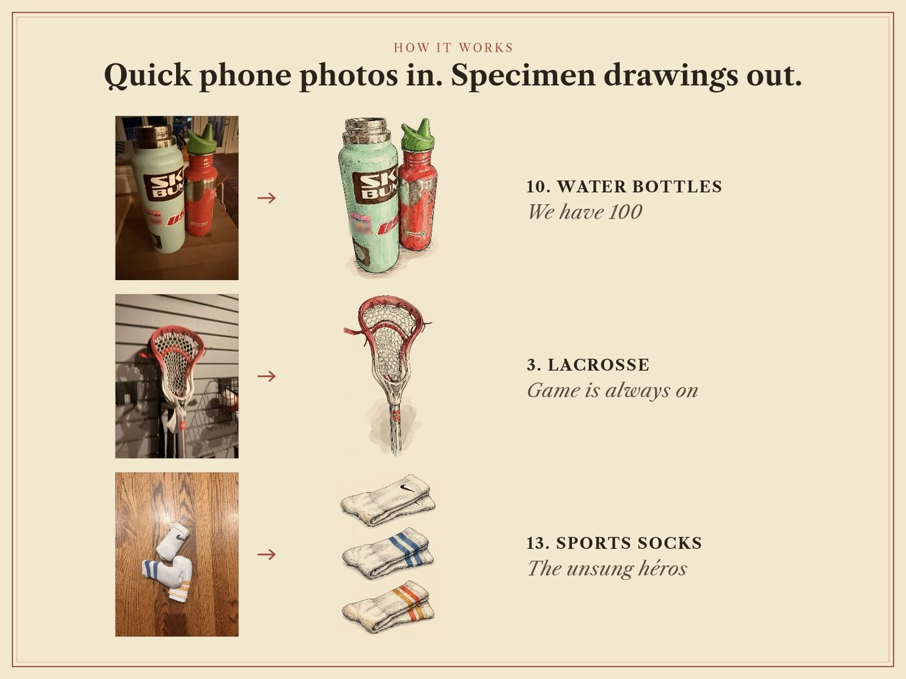
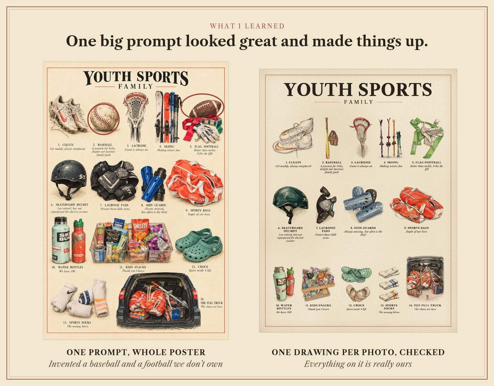

# Family Field Guide

<p align="center"></p>

A skill for Claude Code and Codex that turns photos of your family's everyday things into a poster styled like an old natural-history plate. Think sports gear, the snacks in the pantry, the shoes by the door. Your assistant looks at each photo and writes a name and a one-line caption in your family's voice. Gemini redraws each object from its photo as a hand-coloured engraving. You get a print-ready PNG and PDF, 18 × 24 in at 300 DPI by default.

It shows you the captions to edit before drawing, quotes the cost before spending anything, and checks every drawing against its photo, redrawing any that changed the object. All poster text is typeset by a script, so spelling is always exact.



## Install

**Easiest:** paste this into Claude Code or Codex.

```text
Install the Family Field Guide skill from https://github.com/jacobksamuelson/family-field-guide-skill by following the "For AI agents" steps in its README. Then tell me whether GEMINI_API_KEY is set, and if it isn't, walk me through getting one.
```

**Or run one command yourself:**

```bash
npx skills add jacobksamuelson/family-field-guide-skill -g -a claude-code -a codex -y
```

Then start a new session. It needs Node 18 or newer. The skill installs its one package the first time it runs.

**For the drawings,** create a Gemini API key at https://aistudio.google.com/apikey and add `export GEMINI_API_KEY=...` to your shell profile. Drawings cost about $0.14 each on your own Google account, so about $1.90 for a 14-thing poster. Without a key you can still make the free photo version: your photos, toned like old prints, with nothing sent anywhere.

## Use

Ask your assistant something like:

- "Make a field guide poster from the photos in ~/Desktop/gear."
- "Turn these kitchen photos into a vintage specimen print."
- "Redraw number 4. The bottle should be red, not orange."

It asks who's in your family first. Names and a fact or two are what make the captions sound like you.

## For AI agents

Install steps, in order. Stop and report if a step fails.

1. Check `node --version` is 18 or newer. If not, tell the user to install Node from https://nodejs.org and stop.
2. Run `npx skills add jacobksamuelson/family-field-guide-skill -g -a claude-code -a codex -y`. If that works, go to step 4.
3. If step 2 fails, install by hand. Clone the repo to `~/code/family-field-guide-skill` (`git clone https://github.com/jacobksamuelson/family-field-guide-skill ~/code/family-field-guide-skill`). Then link its `family-field-guide` folder into the skills folder for this agent: `~/.claude/skills/family-field-guide` for Claude Code, or `~/.agents/skills/family-field-guide` for Codex. Use `ln -s` and create the parent folder if it's missing.
4. Run `node <skills folder>/family-field-guide/scripts/ffg.mjs` with no arguments. The first run installs its one package. Then it should print a usage message.
5. Check whether `GEMINI_API_KEY` is set (`echo ${GEMINI_API_KEY:+set}`). Never print the key itself. If it's missing, tell the user that drawings need a key from https://aistudio.google.com/apikey added to their shell profile, and that the free photo style works without one.
6. Tell the user to start a new session so the skill loads. Give them one example request to try.

## Why one drawing per photo



Asking for the whole poster in one prompt looked great and made things up: a baseball and a football the family doesn't own. So the skill draws each object from its own photo, then has your assistant check every drawing against that photo and redraw the misses. Code typesets the words.

## How it works

`family-field-guide/scripts/ffg.mjs` has four steps: `prepare` (upright copies and previews of the photos), `draw` (Gemini, three at a time, and it won't spend without `--yes`), `review` (a photo → drawing check sheet), and `render` (preview, then the final PNG and PDF). The poster engine in `family-field-guide/engine/` is shared with the Family Field Guide web app, so both make the same posters. Fonts are Libre Caslon Text under the SIL Open Font License. You can also unzip `dist/family-field-guide.zip` into your skills folder instead of using the installer.

Only `draw` uses the network. It sends each cropped photo to Google's Gemini API with your key. Everything else stays on your machine.

Maintainer: Jacob Samuelson.
